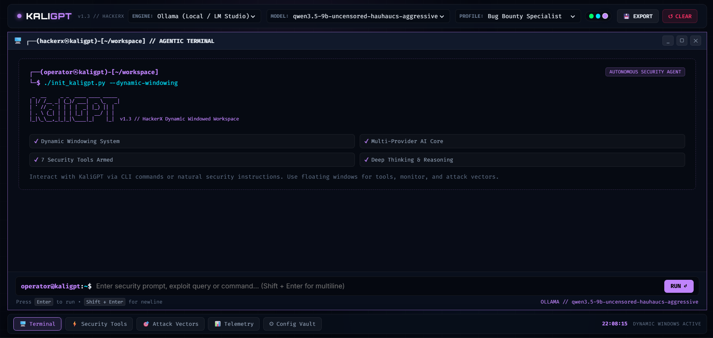

[//]: #  ( Kasinathan P S - KaliGPT )
[//]: #  ( Updated: 2026 )


# KaliGPT v1.3 
**KaliGPT** : An Agentic assistance in Linux CLI and Dynamic Web View for Ethical Hacking & Cybersecurity to use AI with ease to learn and master CyberSecurity.

### **⭐ Star this repo if you found it helpful!**

**Creator & Maintainer:** [Kasinathan P S](https://github.com/cashiiyy) (cashiiyy)

## Badges
<div align="center">

 
<!-- Repository Statistics -->
[](https://github.com/SudoHopeX/KaliGPT/tags)
[](https://github.com/cashiiyy/kaligpt/stargazers)
[](https://github.com/cashiiyy/kaligpt/network/members)
 
<!-- Traffic & Clones (Dynamic JSON) -->


<!-- Project & Community Badges -->
[](LICENSE)
[](https://github.com/cashiiyy/kaligpt/issues/new)
</div>

------
<!-- Feature & Support Badges -->
<div align="center">
 


[](https://github.com/cashiiyy/kaligpt)
</div>

------
<!-- Available Backends-->
<div align="center">


</div>

## 🌐 Dynamic Web View (Hacker Terminal)

<div align="center">
  
</div>

KaliGPT now features an **interactive, spacious dynamic web terminal** equipped with:
- **Full Markdown Output Rendering:** Tables, lists, quotes, and syntax-highlighted code blocks with 1-click clipboard copy.
- **Deep Reasoning & Thought Tracing:** Collapsible trace views for reasoning models (DeepSeek, Qwen, Think stages).
- **Armed Security Tools Suite:** Real-time tool execution panel with parameter editing and output inspection.
- **Provider & Model Switching:** Instantly swap between local Ollama / LM Studio and cloud backends (Gemini, ChatGPT, OpenRouter).
- **Session Export:** 1-click export of chat sessions into clean Markdown (`.md`).
- **Cyber Aesthetics & Themes:** Custom themes (Kali Emerald, Cyber Cyan, Ghost Purple) with spacious typography and terminal layout.

### Commands to Launch Dynamic Web View
```bash
# Launch interactive dynamic web view in browser (Default: http://127.0.0.1:5000)
kaligpt --webview

# Or using short flag
kaligpt -w

# Or via Python module directly
python -m agents -w

# Custom host / port:
python -m agents.web_ui --host 0.0.0.0 --port 8080
```

---

## Installation

1. Download KaliGPT Installer
    ```bash
    curl -sL https://raw.githubusercontent.com/cashiiyy/kaligpt/refs/heads/hackerx/install.sh | bash
    ```
    > Note: Use within permitted directory without root user
2. Install KaliGPT ( don't use sudo in Termux )
   ```bash
   sudo bash kaligptinstaller.sh
   ```

## KaliGPT Usages
use command `kaligpt -h` to see below usages after installation

```help
  HackerX (KaliGPT v1.3) - Use AI in Linux via CLI easily
                         - by Kasinathan P S (cashiiyy)

Usages:
        kaligpt [MODE(Optional)] [Prompt(Optional)]

MODES:
    -w  [--webview]           =  launch Dynamic Web View / Web Terminal
    -g  [--gemini]            =  use Gemini models (Online)
    -o  [--ollama]            =  use local models via Ollama (Offline, cloud: online)
    -or [--openrouter]        =  use OpenRouter models (Online)
    -c  [--chatgpt]           =  use OpenAI models (Online)
    -ll [--litellm]           =  use 100+ providers via LiteLLM (Online)
    --web                     =  AIs official Web-Chat Opener (Online)
    --setup-keys              =  setup API keys for online models
    -u [--update]             =  update KaliGPT to latest version
    -v [--version]            =  show KaliGPT version and exit
    -lr [--list-providers]    =  list KaliGPT available providers (vendors)
    -h  [--help]              =  show this help message and exit

Model Management:
    /change-model             = change to a different AI model
    /reset-to-default-model   = reset to KaliGPT default AI model
    /list-tools               = list available tools for AI Agent

Examples:
     kaligpt --webview        (launches dynamic web terminal in browser)
     kaligpt                  (uses default model and interactive CLI prompt)
     kaligpt "Help me find XSS on target.com"
     kaligpt -o "Analyze this log"
     kaligpt -g "How to Scan a website for subdomains using tools"
```

## Requirements
Read all Requirements [here](/requirements/globals.md)

## Disclaimer
> [!WARNING]
> :warning: HackerX (KaliGPT v1.3) is in active development. Contribute by raising an issue or [sending a PR](https://github.com/cashiiyy/kaligpt/pulls).
>
> Access to this library and the use of information, materials (or portions thereof), is **<u>not intended</u>, and is <u>prohibited</u>, where such access or use violates applicable laws or regulations**. By no means the authors encourage or promote the unauthorized tampering with running systems. This can cause serious human harm and material damages.
>
> *By no means the authors of HackerX (KaliGPT v1.3) encourage or promote the unauthorized tampering with compute systems. Please don't use the source code in here for cybercrime. <u>Pentest for good instead</u>*. By downloading, using, or modifying this source code, you agree to the terms of the [`LICENSE`](LICENSE) and the limitations outlined in the [`DISCLAIMER`](DISCLAIMER) file.

---
<div align="center">
  Developed by <a href="https://github.com/cashiiyy"><strong>Kasinathan P S (cashiiyy)</strong></a>
</div>   
